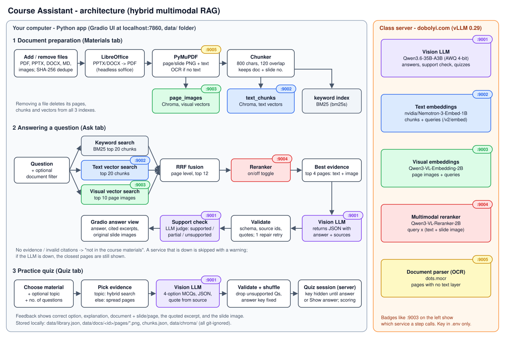
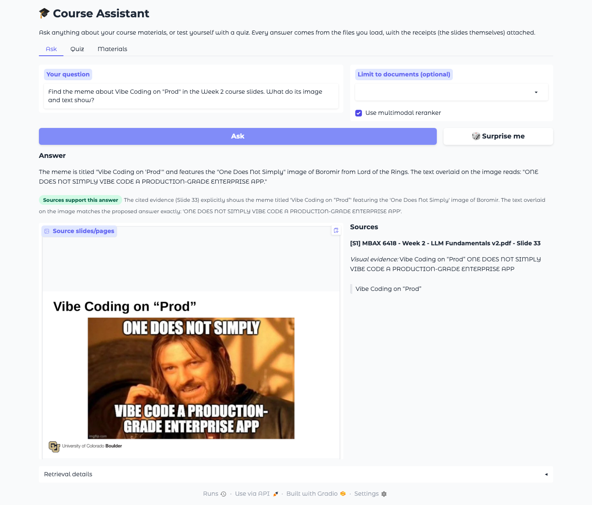
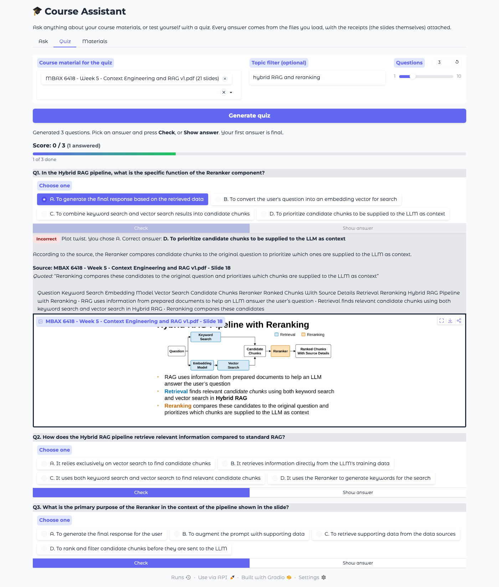

# Course Assistant: multimodal RAG for MBAX 6418

A Python + Gradio app that answers questions about course materials (slides, syllabus, handouts) and generates
practice quizzes. Every answer and every quiz explanation shows the **document, slide/page number, a real
excerpt, and a picture of the original slide**. When the materials don't cover a question, the app says so
instead of guessing.



> **Status:** <!-- STATUS -->Complete. The app was run against the live class endpoints on Oct 16, 2026:
> all 4 live service tests passed, and the 8-question evaluation and the screenshots below come from that run.
> See [What was tested](#what-was-tested-and-what-remains-unchecked).<!-- /STATUS -->

---

## Contents
1. [Features](#features)
2. [Setup](#setup)
3. [Using the app](#using-the-app)
4. [Supported file formats](#supported-file-formats)
5. [How it works](#how-it-works-architecture)
6. [Tests](#tests)
7. [Evaluation: reranker on vs off](#evaluation-reranker-on-vs-off)
8. [Screenshots](#screenshots)
9. [What was tested and what remains unchecked](#what-was-tested-and-what-remains-unchecked)
10. [Limitations](#limitations-and-failures-we-investigated)
11. [Team workflow](#team-workflow)

## Features

- **Manage materials:** add and remove PDF, PowerPoint, Word, Markdown/text and image files from the UI. Re-uploading
  an identical file is skipped (SHA-256 check). Uploading a changed file with the same name replaces the old
  version. Removing a file deletes its pages, chunks and vectors from **all** indexes, so later answers can't use it.
- **Original page images:** every page/slide is rendered to PNG and kept, and the app shows these images as evidence.
  The Materials tab has a preview so you can check that converted slides look right.
- **Hybrid multimodal RAG:** BM25 keyword search, text-embedding search, and visual-embedding search over page
  images, kept in **separate indexes**. Results are fused with reciprocal rank fusion and reranked by a
  multimodal reranker that looks at each candidate's text **and** slide image.
- **Grounded answers:** the vision LLM receives the top pages (text + images) and must return JSON with separate
  `answer` and `sources` fields. The app validates the JSON, checks that every cited source exists, and checks
  that quoted text really appears on that page. It then runs a second "support check" pass that judges whether
  the cited evidence supports the answer. Unverifiable citations are removed, never shown.
- **Practice quizzes:** choose documents and an optional topic. The app generates 4-option multiple-choice
  questions, each tied to a source quote. The answer key is fixed when the quiz is generated and kept on the
  server. Solutions stay hidden until you answer (first answer is final) or press **Show answer**. Scores are
  computed from the key.
- **A little fun:** a 🎲 *Surprise me* button suggests a question to try. Quizzes show a progress bar and a 🔥 streak
  counter (peeking with *Show answer* resets it), give varied feedback, and end with a message based on your score.
- **Graceful failures:** if a model service is down, the other retrievers keep working and you see a warning. If
  the LLM is down, the closest pages are still shown. API keys never appear in the UI, logs or errors.

## Setup

### 1. Requirements
- Python **3.10-3.13**
- **LibreOffice** (only needed to upload `.pptx`/`.docx` directly):
  - macOS: `brew install --cask libreoffice` or download from <https://www.libreoffice.org/download/>
  - Windows: install from the website (the app looks in `C:\Program Files\LibreOffice\program\`)
  - Linux: `sudo apt install libreoffice-impress libreoffice-writer`
  - If it is installed somewhere unusual, set `SOFFICE_PATH` in `.env`. Without LibreOffice, export decks to PDF
    (PowerPoint: *File > Export > PDF*) and upload the PDF instead.
- Network access to the class server `dobolyi.com` ports 9001-9005 (campus network / VPN as required).

### 2. Install
```bash
git clone <your-repo-url> course-assistant
cd course-assistant
python3 -m venv .venv
source .venv/bin/activate          # Windows: .venv\Scripts\activate
pip install -r requirements.txt    # add -dev for tests: pip install -r requirements-dev.txt
```

### 3. Configure the endpoints and key (never commit it)
```bash
cp .env.example .env               # .env is git-ignored
```
Open `.env` and set `COURSE_API_KEY` to the class key (ask the team). All endpoints default to the class
services. Override any `*_BASE_URL` / `*_MODEL` in `.env` if they change:

| Service | Port | Model | Used for |
|---|---|---|---|
| Vision LLM | 9001 | `cyankiwi/Qwen3.6-35B-A3B-AWQ-4bit` | answers, support check, quizzes |
| Text embeddings | 9002 | `nvidia/Nemotron-3-Embed-1B-BF16` | chunk + query vectors (`/v2/embed`) |
| Visual embeddings | 9003 | `Qwen/Qwen3-VL-Embedding-2B` | page-image + query vectors |
| Multimodal reranker | 9004 | `Qwen/Qwen3-VL-Reranker-2B` | rerank text + slide image candidates (`/rerank`) |
| Document parser | 9005 | `dots.mocr` | OCR for pages/images without a text layer |

The key is read only from the environment / `.env` on the server side (Python). It is never sent to the browser,
and error messages are scrubbed of it.

### 4. Launch
```bash
python -m course_assistant.app             # open http://127.0.0.1:7860
python -m course_assistant.app --port 7861 --data-dir my_data   # options
```
The library (page images, chunks, Chroma vectors) is stored in `data/` and survives restarts. Delete `data/`
to start over.

## Using the app

- **Materials tab:** drop files in *Add course files* and click **Add to library**. A progress bar shows conversion,
  OCR and embedding. A 42-slide deck takes about 30 s to convert, plus embedding time. Use **Remove** to delete a
  document. Use *Check a converted page/slide* to view any rendered slide and its extracted text.
- **Ask tab:** type a question. You can limit the search to certain documents, and the *Use multimodal reranker*
  checkbox turns reranking on or off. The answer shows a support badge, the sources (document, slide/page,
  quoted text or visual evidence, excerpt) and the original slide images. *Retrieval details* lists each
  candidate's rank from every retriever plus timings.
  - Try: `Find the meme about Vibe Coding on "Prod" in the Week 2 course slides.`
  - Try: `What does the chart on the "LLMs Changed Things...Forever?" slide show?`
  - Try: `What is Professor Dobolyi's office phone number?` (not in the materials, so the app says so)
- **Quiz tab:** pick one or more documents, an optional topic (e.g. `chunking`) and the number of questions, then
  **Generate quiz**. For each question, choose an option and press **Check**, or press **Show answer**. Feedback
  shows correct/incorrect, the explanation, and the source with its excerpt and slide image. The running score
  is at the top.

## Supported file formats

| Format | How it is processed |
|---|---|
| `.pdf` | Each page is rendered to PNG (PyMuPDF) and its text extracted. Landscape PDFs are labeled "Slide N". Pages with no text layer (scans) are OCR'd with dots.mocr. |
| `.pptx`, `.ppt`, `.odp` | Converted to PDF with headless LibreOffice, then handled like a PDF (labeled "Slide N"). For `.pptx`, speaker notes are added to each slide's text when the slide count matches. |
| `.docx`, `.doc`, `.odt`, `.rtf` | Converted to PDF with LibreOffice, then handled like a PDF ("Page N"). |
| `.md`, `.markdown`, `.txt` | Split into sections at headings (Markdown) or blank-line blocks ("Section N: heading"). No images. |
| `.png`, `.jpg`, `.jpeg`, `.webp` | Stored as a one-page document. Text comes from OCR (dots.mocr) and the image gets a visual embedding. |

**Manual conversion alternative:** in PowerPoint or Keynote, *File > Export > PDF*, then upload the PDF.

**Checking conversions:** we looked at the LibreOffice renders of all 42 Week 2 slides (as a contact sheet) and
slide 33 (the meme) at full size. Text, images and charts were intact. Use the Materials tab preview to compare
any slide with PowerPoint. LibreOffice may substitute fonts that aren't installed, and it skips hidden slides.

## How it works (architecture)

The diagram at the top (`docs/architecture.svg`, generated by `docs/make_architecture_svg.py`) shows the three
flows. Everything on the left runs **on your computer** in one Python process. Everything on the right runs on
the **class server** (vLLM 0.29).

1. **Document preparation** (`course_assistant/documents.py`, `store.py`): file, then LibreOffice (Office formats),
   then PyMuPDF renders page PNGs and extracts text (OCR if a page has none), then
   `RecursiveCharacterTextSplitter` (800 chars, 120 overlap) makes chunks that keep the document name, page
   number and label. Three separate indexes are built:
   - `keyword`: BM25 (`bm25s`), rebuilt in memory from `chunks.json` files
   - `text_chunks`: Chroma collection of text embeddings (port 9002)
   - `page_images`: Chroma collection of visual embeddings of page images (port 9003)
2. **Answering** (`retrieval.py`, `answering.py`):
   - Retrieve the keyword top 20 chunks, text-vector top 20 chunks, and visual top 10 page images.
   - Fuse them at the page level with RRF and keep the top 12 candidates.
   - The multimodal reranker (port 9004) scores each candidate using its text and slide image together.
   - The top 4 pages, with up to 4 slide images, go to the vision LLM (port 9001) along with the question and
     the answering rules. The LLM returns JSON `{found, answer, sources[{source_id, quote, evidence_type}]}`.
   - Validation runs pydantic schema checks, checks that each source id exists, and checks that the quote
     appears on the page, with one repair retry. A support-check LLM call then returns
     supported / partial / unsupported.
   - Structured outputs (`response_format: json_schema`) are requested, with an automatic fallback if the server
     doesn't support them.
3. **Quiz** (`quiz.py`):
   - Pick the material: hybrid search for the topic, or evenly spread pages from the chosen documents.
   - The LLM writes JSON questions, each with a source id and quote.
   - Questions are validated: exactly 4 distinct options, a valid key, and a quote found in the source.
     Questions that fail are dropped.
   - Options are shuffled, which fixes the answer key. A `QuizSession` (server-side `gr.State`) holds the key
     and reveals it per question only after an answer or **Show answer**.

| File | Purpose |
|---|---|
| `course_assistant/config.py` | settings from env / `.env` |
| `course_assistant/clients.py` | HTTP clients for the 5 services (request formats per vLLM 0.29 docs), key redaction |
| `course_assistant/documents.py` | format detection, LibreOffice conversion, rendering, chunking |
| `course_assistant/store.py` | library manifest, dedupe, add/remove, the three indexes |
| `course_assistant/retrieval.py` | hybrid search, RRF, reranking |
| `course_assistant/answering.py` | prompts, JSON schema, validation, support check |
| `course_assistant/quiz.py` | quiz generation, validation, scoring |
| `course_assistant/app.py` | Gradio UI |
| `eval/` | question set and evaluation script |
| `tests/` | unit, end-to-end, browser UI and live tests |

## Tests

```bash
pip install -r requirements-dev.txt
python -m playwright install chromium   # once, for the browser UI test
pytest                                  # unit + end-to-end + UI (offline, ~20 s)
pytest -m live -v                       # real class services (needs .env and network)
```

- **Unit tests** (`tests/test_unit.py`) cover JSON extraction, quote verification, schema validation, chunk
  metadata, RRF fusion, quiz-session rules (hidden key, first answer final, scoring, streaks), and the exact HTTP payloads
  sent to each service. They also check fallbacks (no `input_type`, no `response_format`) and that keys never
  appear in errors.
- **End-to-end tests** (`tests/test_e2e.py`) run the real pipeline (rendering, BM25, Chroma, LibreOffice) with
  deterministic **fake models** (`tests/fakes.py`) so results are repeatable. They cover:
  - add, duplicate, replace and remove, plus persistence across restarts
  - text, meme and chart questions, missing information, invented-citation removal and the JSON repair retry
  - document filters and the reranker toggle
  - an embedding service down (ingestion rolls back cleanly), the LLM down, and reranker + text search down
  - OCR of image files
  - quiz generation, scoring and the topic filter
  - PPTX conversion with speaker notes
  - the evaluation harness
- **UI test** (`tests/test_ui.py`) drives the real Gradio app in Chromium:
  - upload, then duplicate upload
  - the *Surprise me* button, then ask the meme question and see the slide
  - generate a quiz, check that solutions are hidden, then show an answer and check the score
  - light and dark screenshots, then remove the document
- **Live tests** (`tests/test_live.py`) check each real service: embeddings rank the relevant text/image higher,
  the reranker prefers the meme slide, the LLM returns JSON, and OCR reads text.

Last offline run: <!-- TESTS -->**45 passed, 4 skipped** (the 4 live tests skip without network access to the class server).<!-- /TESTS -->

## Evaluation: reranker on vs off

**Design choice compared:** multimodal reranking **on** (top 12 fused candidates reranked by Qwen3-VL-Reranker) vs
**off** (top 4 by RRF fusion only). Both runs use the same 8 questions, the same course files and the same index.
The files were the syllabus PDF plus the Week 2, Week 3 and Week 5 decks, converted from PPTX to PDF with LibreOffice
24.2 (the evaluation laptop had no LibreOffice installed; the app's own PPTX upload path is covered by the
automated tests).

```bash
mkdir -p course_files   # git-ignored; copy the syllabus PDF and the Week 2, 3, 5 .pptx files here
python -m eval.run_eval --materials course_files
```
This writes `results/eval_rerank_on.json`, `results/eval_rerank_off.json`, `results/eval_results.csv` (with blank
`human_correct` / `human_sources_support` columns for our own grading) and `results/eval_summary.md`.

**Question set** (`eval/questions.json`):

| ID | Type | Question | Expected source |
|---|---|---|---|
| Q1 | syllabus text | What percentage of the final grade is the final project worth? | Syllabus p.3 (45%) |
| Q2 | syllabus text | What is the penalty for turning in an assignment late, and what is the latest it can be submitted? | Syllabus p.2-3 (10%/day, max 5 days) |
| Q3 | slide text | What is speculative decoding? | Week 2 slide 13 |
| Q4 | slide text | In a hybrid RAG pipeline, what does the reranker do? | Week 5 slide 18 |
| Q5 | **visual** (meme) | Find the meme about Vibe Coding on "Prod" in the Week 2 slides. What do its image and text show? | Week 2 slide 33 |
| Q6 | **visual** (chart) | On "LLMs Changed Things...Forever?", what does the chart show about Stack Overflow questions? | Week 2 slide 28 |
| Q7 | **visual** (chart) | On "Context Location Matters?", how does accuracy change with the relevant document's position? | Week 5 slide 7 |
| Q8 | missing info | What is Professor Dobolyi's office phone number? | none: must say it's not in the materials |

Auto-grading: *correct* means the answer contains the expected key facts (keyword groups in `questions.json`) and
was marked found, or, for Q8, the app declined. *Cited the expected source* means one of the cited pages is the
expected page. *Expected page in evidence* checks retrieval alone. We then graded every answer by hand
(`human_correct` column) because keyword checks can miss paraphrases.

### Results

<!-- RESULTS -->
Run on Oct 16, 2026 against the live class endpoints (`results/eval_summary.md`, full records in
`results/eval_rerank_on.json` / `eval_rerank_off.json`). The LLM was `Qwen3.6-35B-A3B-AWQ-4bit`, with 4 evidence pages
per answer and the support check on.

| Metric | Reranker ON | Reranker OFF |
|---|---|---|
| Correct answers (auto-graded) | 8/8 | 8/8 |
| Correct answers (**our manual check against the slides**) | **7/8** (Q6 partly wrong) | **7/8** (Q6 partly wrong) |
| Cited the expected source | 8/8 | 8/8 |
| Expected page was the **#1** evidence page | 7/7 | 7/7 |
| Support check = "supported" | 7/7 | 7/7 |
| Mean latency per question | **7.0 s** | **2.8 s** |
| Median latency | 6.6 s | 2.8 s |

| Q | Type | Reranker ON: correct / source / time | Reranker OFF: correct / source / time |
|---|---|---|---|
| Q1 | syllabus text | yes / yes / 7.6 s | yes / yes / 2.8 s |
| Q2 | syllabus text | yes / yes / 6.0 s | yes / yes / 2.8 s |
| Q3 | slide text | yes / yes / 7.0 s | yes / yes / 3.7 s |
| Q4 | slide text | yes / yes / 6.2 s | yes / yes / 2.5 s |
| Q5 | visual (meme) | yes / yes / 9.2 s | yes / yes / 2.7 s |
| Q6 | visual (chart) | **partly** / yes / 6.2 s | **partly** / yes / 3.0 s |
| Q7 | visual (chart) | yes / yes / 9.4 s | yes / yes / 3.0 s |
| Q8 | missing info | yes (declined) / no citations / 4.5 s | yes (declined) / no citations / 2.0 s |

**Example answers (live):**
- Q5: *"The meme is titled 'Vibe Coding on "Prod"' and features the 'One Does Not Simply' image of Boromir... The
  text overlaid on the image reads: 'ONE DOES NOT SIMPLY VIBE CODE A PRODUCTION-GRADE ENTERPRISE APP.'"* (Week 2,
  slide 33). The meme's words exist only in the picture, so this answer depends on the vision model reading the slide.
- Q7: *"...a U-shaped performance curve. Model accuracy is highest when the relevant information is at the very
  beginning (primacy bias) or the very end (recency bias)..."* (Week 5, slide 7)
- Q8: *"The provided materials do not contain Professor Dobolyi's office phone number."* (no sources shown)

**Interpretation** _(draft - rewrite in our own words)_: On this question set the reranker did not change answer
quality. Both settings got the same 7 of 8 fully right and cited the right page every time. Hybrid retrieval with RRF
already put the expected page first for every answerable question, so the reranker had nothing to fix. It still cost
about 4 extra seconds per question (2-3.6 s of reranking), making answers about 2.5x slower. The reranker did reorder
the lower evidence slots, and once that hurt slightly: for Q1 it promoted an unrelated Week 3 slide into the evidence.
**We would set the reranker to off by default** for this course-sized library and keep the checkbox for harder
questions. Caveats: 8 questions is a small sample, our questions name their topic clearly (which favors keyword
search), and a larger library or vaguer questions could make reranking worth its cost.
<!-- /RESULTS -->

## Screenshots

<!-- SCREENSHOTS -->
Real screenshots from the live run (`scripts/capture_screenshots.py`):

**Answer with the supporting slide image (Q5, the Vibe Coding meme):**



**Quiz feedback with its source (Week 5, topic "hybrid RAG and reranking"):**



**Dark mode** (same answer): [docs/screenshots/answer_dark.png](docs/screenshots/answer_dark.png)
<!-- /SCREENSHOTS -->

## What was tested and what remains unchecked

**Tested (automated, offline):**
- every unit, end-to-end and UI test listed above, including PPTX conversion with LibreOffice
- the full ingestion pipeline on the real Week 2 and Week 5 decks and the syllabus (with fake models): all 42 + 21
  slides rendered, speaker notes attached, and the Week 2 slide 33 render compared to the original meme
- the HTTP request formats match the vLLM 0.29 documentation for `/v2/embed`, `/v1/embeddings` (chat-style
  `messages`), `/rerank` (multimodal `documents[].content`) and `/v1/chat/completions`
- light and dark mode screenshots for readability

**Live run (Oct 16, macOS, class endpoints):** `pytest -m live`: 4/4 passed (`results/live_tests.txt`). Every
service accepted our request formats. The 8-question evaluation is above, and the full log is in
`results/live_run_log.txt`.

**Remains unchecked:** <!-- UNCHECKED -->
- Windows installation (tested on macOS and Linux only)
- OCR quality of dots.mocr on real scanned handouts (the live test only checks a short synthetic image)
- Direct PPTX upload on a Mac with LibreOffice installed (tested on Linux; the live evaluation used PDFs)
- Quiz quality beyond spot checks: we reviewed the 3-question quiz in the screenshot, not a large sample
<!-- /UNCHECKED -->

## Limitations and failures we investigated

- **A chart misread that our checks missed (Q6).** Both settings answered that Stack Overflow questions had "notable
  drops around the start of COVID-19". The chart actually shows a short **spike** when COVID started, then the
  decline. The keyword auto-grader passed it (it only looks for "declin..."), and the LLM support check called it
  "supported", because the same model judged its own reading of the same image. This is why we graded every
  answer by hand. Ideas: ask the model to describe the chart before answering, or use a different model as judge.
- **Repetitive quiz questions on narrow topics.** A 3-question quiz on "hybrid RAG and reranking" drew mostly on one
  slide, and two questions asked about the reranker's purpose in different words. We drop exact duplicates but not
  paraphrases.
- **macOS test failures we fixed.** On macOS the offline tests first failed (3 failed, 2 errors: an `OSError` and
  Rust panics from Chroma). We reproduced the same failures on Linux by lowering the open-file limit to macOS's
  default of 256. Each test opened its own Chroma database and never closed it. `tests/conftest.py` now raises the
  limit and releases Chroma clients after each test. All tests pass on Linux at the 256-file limit; rerun `pytest`
  on a Mac to confirm.

- **Image-only slides.** The meme slide (Week 2, slide 33) has only the title "Vibe Coding on 'Prod'" as text; the
  meme's words exist only in the picture. Keyword and text search find it only through the title. The visual
  index and reranker are what let the app answer "what does the image say", and the vision LLM has to read the
  picture. Questions that describe the image without using title words depend entirely on visual retrieval.
- **Charts are read, not measured.** The LLM describes trends and labels it can see in the slide image, but exact
  values read off a chart can be imprecise.
- **Validation is strict.** A correct answer whose quote the model paraphrased instead of copying exactly gets its
  citation removed (after one repair attempt), and the app then says it can't answer. We chose to risk false
  "not found" replies rather than show unverifiable citations.
- **Quiz count can be lower than requested** when generated questions fail validation (bad quote, duplicate
  options). The UI says how many were dropped.
- **Speed.** Each answer makes 3 search calls, about 3 reranker calls (batches of 4) and 2 LLM calls (answer +
  support check). Set `SUPPORT_CHECK=false` or turn the reranker off for faster answers. Ingesting a deck makes one
  visual-embedding call per slide.
- **LibreOffice fidelity.** Missing fonts are substituted, hidden slides are skipped, and animations are flattened.
  Speaker notes are only attached when the slide count matches the PDF.
- **Single user, local.** The library is shared by everyone using the same running instance. There are no
  accounts.

## Team contributions

- **Ian Anderson:** built the app with an AI coding agent, ran the live evaluation, checked the answers against the
  slides, and wrote this report.
- **Driss:** _to be filled in after his review of the `fun-quiz-extras` pull request._
- **Ruslan:** did not participate in this assignment.

## Team workflow

See [docs/TEAM_WORKFLOW.md](docs/TEAM_WORKFLOW.md) for the issue plan (with completion checks), the branch / pull
request / review steps, and a glossary. `bash scripts/create_issues.sh` creates the issues with the GitHub CLI.
